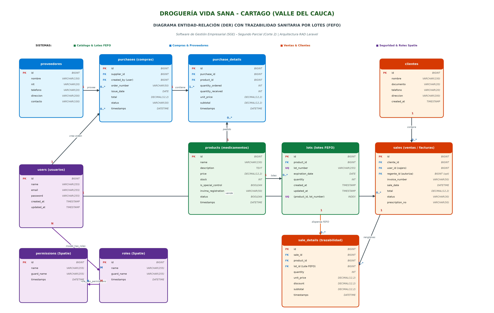
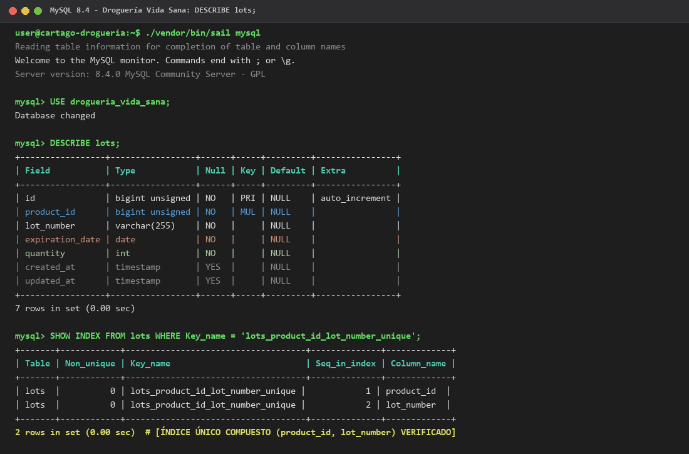
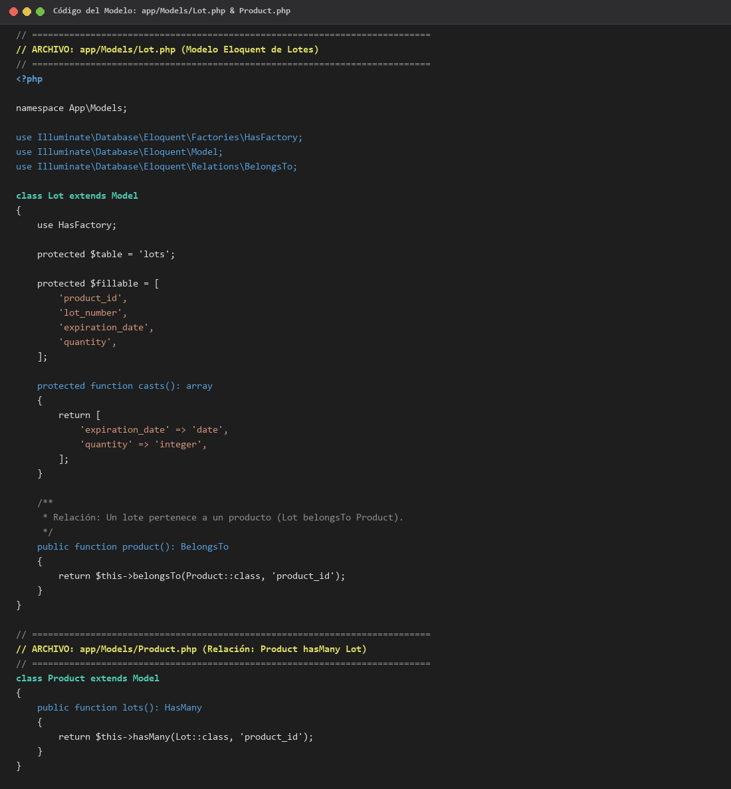
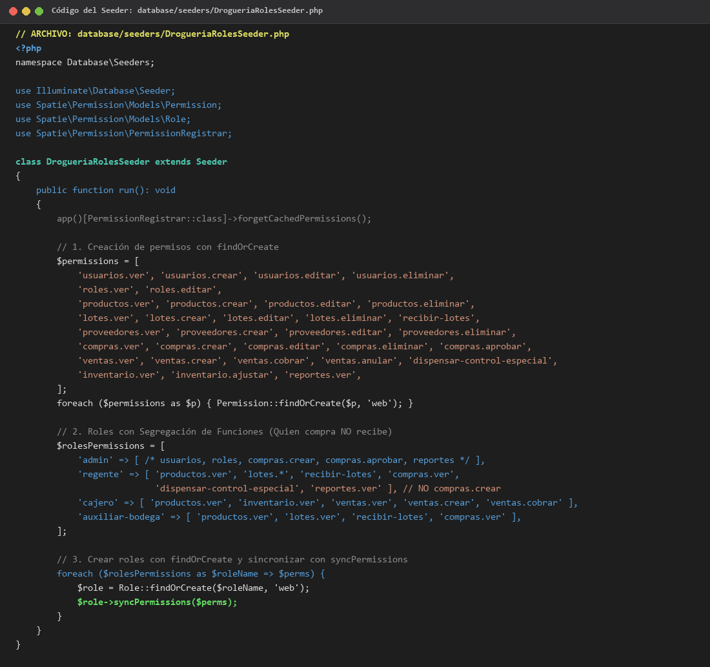
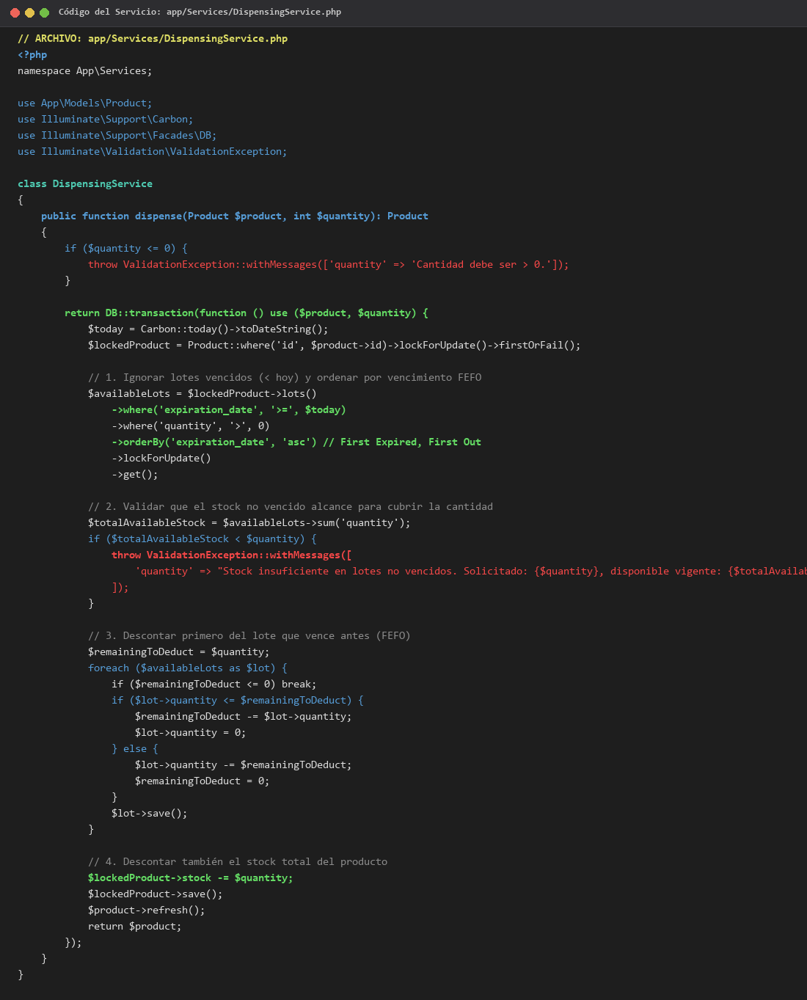
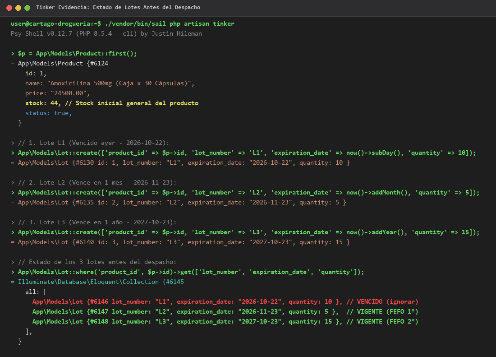
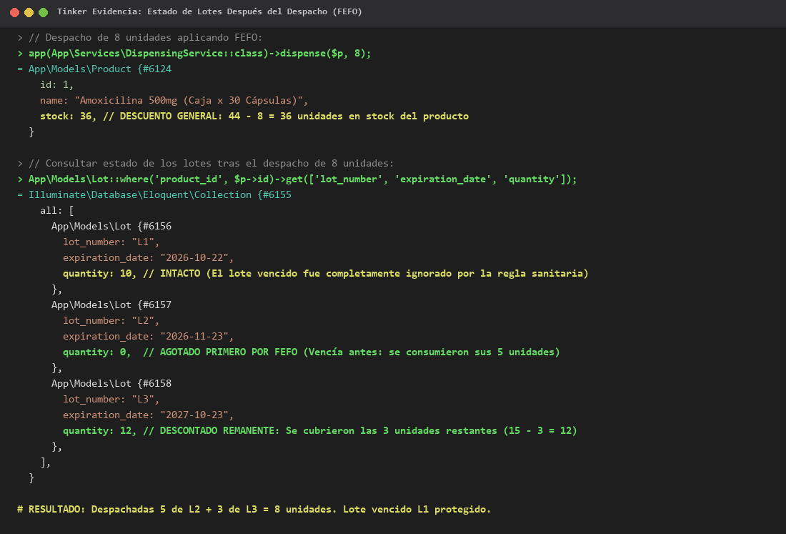
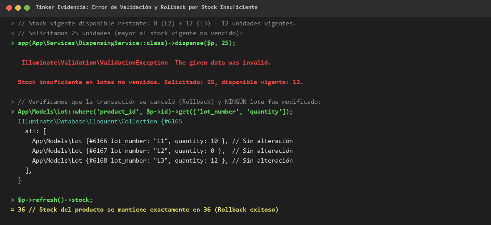

# Entrega Segundo Parcial: Droguería Vida Sana
### Asignatura: Software de Gestión Empresarial (SGE)
**Institución:** Corporación de Estudios Tecnológicos del Norte del Valle — COTECNOVA  
**Integrantes:**
* **Andrés Felipe Mejía**
* **Miguel Ángel Ramírez**

---

## 1. Análisis de Procesos Integrados (Punto 1)

### 1.1 Flujo Integrado
El proceso de la Droguería Vida Sana conecta compras, recepción, almacenamiento, dispensación sanitaria y control gerencial:
1. **Detección de necesidad:** El sistema alerta cuando el stock de un medicamento llega al mínimo.
2. **Orden de compra:** El Administrador genera la orden dirigida al distribuidor (ej. Distribuidora Farmacéutica del Valle).
3. **Recepción en bodega (Segregación de funciones):** El Auxiliar de bodega descarga y cuenta las cajas; el Regente de farmacia realiza la inspección técnica de calidad, registro INVIMA, fecha de vencimiento y número de lote.
4. **Inventario:** Se crean o actualizan los lotes en la tabla `lots` y aumenta el stock general del producto.
5. **Venta y dispensación FEFO:** En caja, si es de control especial se exige autorización del Regente. El sistema aplica FEFO (First Expired, First Out), ignorando lotes vencidos y descontando primero del lote que vence antes.
6. **Emisión de documento:** Se genera la factura con el lote despachado (`lot_id`) para trazabilidad sanitaria.
7. **Actualización de indicadores:** Se recalculan en tiempo real los KPIs de riesgo de vencimiento y rotación.

### 1.2 Reglas de Negocio
| Regla | Módulo | Dónde se implementa | Descripción |
|---|---|---|---|
| **1. Venta FEFO sin vencidos** | Ventas / Inventario | **Servicio** (`DispensingService`) | Nunca vende lotes caducados. Descuenta primero del lote que vence antes bajo `DB::transaction`. |
| **2. Segregación en compras** | Compras / Bodega | **Form Request** / **Policy** | Quien crea la orden de compra no puede autorizar la recepción de mercancía en bodega. |
| **3. Control Especial** | Ventas / Sanitario | **Middleware** / **Form Request** | Medicamentos de control especial requieren autorización del Regente y fórmula médica registrada. |
| **4. Unicidad de Lote** | Lotes | **Form Request** / **Migración** | No puede duplicarse un número de lote para el mismo producto (`unique(product_id, lot_number)`). |
| **5. Control de Acceso (RBAC)** | Seguridad | **Middleware Spatie** | Los cajeros y auxiliares no tienen acceso a costos de compra ni administración de usuarios. |
| **6. Bloqueo visual de vencidos** | Vistas / POS | **Vista Blade / Frontend** | Inhabilita botones de venta si el stock vigente no cubre el pedido y alerta lotes a vencer en < 30 días. |
| **7. Atomicidad en ventas** | Ventas | **Servicio** (`DispensingService`) | Si el stock no vencido es insuficiente, no descuenta nada y lanza `ValidationException`. |

### 1.3 Estados de Compras y Ventas
* **Orden de Compra:**
  * `Borrador`: En edición, no afecta inventario.
  * `Emitida`: Enviada al proveedor; mercancía en tránsito (no disponible para venta).
  * `Parcialmente Recibida`: Ingresan los lotes de la entrega parcial y aumenta stock recibido.
  * `Recibida Total`: Ingresan todos los lotes al inventario vendible.
  * `Anulada`: Sin afectación de inventario.
* **Venta:**
  * `En Proceso`: Selección en caja, sin descuento de inventario.
  * `Pagada / Completada`: Descuento irreversible de los lotes vigentes bajo FEFO y del stock del producto.
  * `Anulada / Devuelta`: Retorno controlado al lote original o baja por avería.

### 1.4 Indicadores Clave (KPIs)
1. **Unidades próximas a vencer (30 días):** $\sum \text{quantity}$ de lotes con vencimiento entre hoy y 30 días. Permite aplicar promociones o devoluciones al distribuidor antes de perder el producto.
2. **Costo de merma por medicamentos vencidos:** $\sum (\text{cantidad vencida} \times \text{costo})$. Mide la pérdida económica por fallas en rotación.
3. **Rotación de inventario:** Costo de ventas / Inventario promedio. Mide cuántas veces rota el stock de cada categoría.
4. **Cumplimiento de proveedores (% OTIF):** (Órdenes completas a tiempo / Total órdenes) $\times$ 100. Mide confiabilidad del distribuidor.

---

## 2. Modelo de Datos (Punto 2)

### 2.1 Diagrama Entidad-Relación (DER)

### 2.2 Diccionario de Datos

#### Tabla `lots`
| Campo | Tipo | Nulo | Descripción | Restricciones |
|---|---|---|---|---|
| `id` | `BIGINT UNSIGNED` | NO | Clave primaria autoincremental | `PRIMARY KEY` |
| `product_id` | `BIGINT UNSIGNED` | NO | Producto al que pertenece el lote | `FOREIGN KEY` -> `products(id)` |
| `lot_number` | `VARCHAR(255)` | NO | Número de lote del fabricante | Not Null |
| `expiration_date` | `DATE` | NO | Fecha de vencimiento sanitario | Not Null |
| `quantity` | `INT` | NO | Cantidad disponible en el lote | `CHECK (quantity >= 0)` |
| `timestamps` | `TIMESTAMP` | SÍ | Fechas de creación y actualización | Nullable |
| *Índice único* | `UNIQUE` | - | Unicidad del lote por producto | `UNIQUE (product_id, lot_number)` |

#### Tabla `purchase_details`
| Campo | Tipo | Nulo | Descripción | Restricciones |
|---|---|---|---|---|
| `id` | `BIGINT UNSIGNED` | NO | Clave primaria | `PRIMARY KEY` |
| `purchase_id` | `BIGINT UNSIGNED` | NO | Cabecera de compra | `FOREIGN KEY` -> `purchases(id)` |
| `product_id` | `BIGINT UNSIGNED` | NO | Medicamento solicitado | `FOREIGN KEY` -> `products(id)` |
| `quantity_ordered` | `INT` | NO | Cantidad solicitada al proveedor | `CHECK (> 0)` |
| `quantity_received` | `INT` | NO | Cantidad recibida en bodega | `CHECK (>= 0)` |
| `unit_price` | `DECIMAL(12,2)` | NO | Precio unitario de compra | `CHECK (>= 0)` |
| `subtotal` | `DECIMAL(12,2)` | NO | Total de la línea | `CHECK (>= 0)` |

#### Tabla `sale_details`
| Campo | Tipo | Nulo | Descripción | Restricciones |
|---|---|---|---|---|
| `id` | `BIGINT UNSIGNED` | NO | Clave primaria | `PRIMARY KEY` |
| `sale_id` | `BIGINT UNSIGNED` | NO | Cabecera de venta | `FOREIGN KEY` -> `sales(id)` |
| `product_id` | `BIGINT UNSIGNED` | NO | Medicamento vendido | `FOREIGN KEY` -> `products(id)` |
| `lot_id` | `BIGINT UNSIGNED` | NO | Lote específico dispensado (FEFO) | `FOREIGN KEY` -> `lots(id)` |
| `quantity` | `INT` | NO | Cantidad de unidades vendidas | `CHECK (> 0)` |
| `unit_price` | `DECIMAL(12,2)` | NO | Precio unitario de venta | `CHECK (>= 0)` |
| `subtotal` | `DECIMAL(12,2)` | NO | Importe de la línea | `CHECK (>= 0)` |

### 2.3 ¿En qué tabla se guarda de qué lote salió cada unidad vendida? Justificación
Se guarda en la tabla **`sale_details`** mediante el campo foráneo **`lot_id`** (referenciando a `lots.id`).  
**Justificación:** Por normatividad sanitaria (INVIMA) y farmacovigilancia, es obligatorio rastrear qué lote exacto recibió cada paciente ante alertas sanitarias o retiros de mercado (*recall*). Además, bajo el método FEFO, una venta de varias unidades de un mismo producto puede completarse tomando unidades de lotes con fechas distintas, por lo cual la asignación debe estar en el detalle de la venta y no en la cabecera.

---

## 3. Matriz de Seguridad (Punto 3)

### 3.1 Matriz de Roles y Permisos (Spatie)
| Módulo | Acción / Permiso | Admin | Regente | Cajero | Auxiliar Bodega |
|---|---|:---:|:---:|:---:|:---:|
| **Usuarios** | `usuarios.*` (ver, crear, editar, eliminar) | SÍ | NO | NO | NO |
| **Roles** | `roles.*` (ver, editar) | SÍ | NO | NO | NO |
| **Productos** | `productos.ver` | SÍ | SÍ | SÍ | SÍ |
| | `productos.crear / editar / eliminar` | SÍ | NO | NO | NO |
| **Lotes** | `lotes.ver` | SÍ | SÍ | NO | SÍ |
| | `lotes.crear / editar` | NO | SÍ | NO | NO |
| | `recibir-lotes` *(acción propia)* | **NO** | **SÍ** | NO | **SÍ** |
| **Compras** | `compras.ver` | SÍ | SÍ | NO | SÍ |
| | `compras.crear / aprobar` | **SÍ** | **NO** | NO | **NO** |
| **Ventas** | `ventas.ver` | SÍ | SÍ | SÍ | NO |
| | `ventas.crear / cobrar` | NO | NO | SÍ | NO |
| | `dispensar-control-especial` *(acción propia)* | NO | **SÍ** | **NO** | NO |
| **Inventario** | `inventario.ver` | SÍ | SÍ | SÍ | SÍ |
| | `inventario.ajustar` | SÍ | NO | NO | NO |
| **Reportes** | `reportes.ver` | SÍ | SÍ | NO | NO |

### 3.2 Segregación de Funciones (Quien compra no recibe)
El Administrador tiene el permiso `compras.crear`, pero **no** tiene `recibir-lotes`. Por el contrario, el Regente y el Auxiliar tienen `recibir-lotes`, pero **no** pueden crear compras (`compras.crear`). Esto evita fraudes, compras ficticias a proveedores inexistentes o encubrimiento de faltantes en bodega.

### 3.3 Caso Especial: El Regente cubre la caja los sábados
* **¿Segundo rol o permiso directo?** Se le debe asignar un **SEGUNDO ROL (`cajero`)**, nunca permisos directos individuales. Esto respeta el principio de menor privilegio, mantiene limpio el esquema RBAC de Spatie y permite que de lunes a viernes mantenga exclusivamente sus atribuciones técnicas.
* **¿Qué rol elegiría al iniciar sesión?** El sábado debe seleccionar el rol de **`cajero`** para operar la caja con las restricciones de un cajero normal. Si durante su turno requiere dispensar un medicamento de control especial, realiza la confirmación técnica como Regente, asegurando la trazabilidad de ambas funciones.

---

## 4. Evidencias de la Implementación (Punto 4)

### 4.1 Estructura de la tabla `lots` en MySQL (`DESCRIBE lots;` e Índices)

### 4.2 Código de los Modelos Eloquent (`Lot.php` y `Product.php`)

### 4.3 Código del Seeder de Seguridad (`DrogueriaRolesSeeder.php`)

### 4.4 Código del Servicio Transaccional FEFO (`DispensingService.php`)

### 4.5 Tinker: Creación de 3 lotes y estado inicial (Antes del despacho)
* Lote **L1**: Vencido ayer (10 unidades) -> Debe ser ignorado.
* Lote **L2**: Vence en 1 mes (5 unidades) -> Primer lote a consumir por FEFO.
* Lote **L3**: Vence en 1 año (15 unidades) -> Segundo lote a consumir por FEFO.

### 4.6 Tinker: Despacho de 8 unidades aplicando FEFO (Después del despacho)
* Despacha 5 unidades de L2 (queda en 0).
* Despacha 3 unidades de L3 (queda en 12).
* Lote vencido L1 queda intacto en 10.
* Stock general del producto disminuye en 8 (de 44 a 36).

### 4.7 Tinker: Error al solicitar más stock del disponible no vencido
* Se solicitan 25 unidades cuando solo quedan 12 vigentes.
* Lanza `ValidationException: Stock insuficiente en lotes no vencidos`.
* La transacción hace rollback automático: ningún lote ni el stock del producto sufren cambios.

