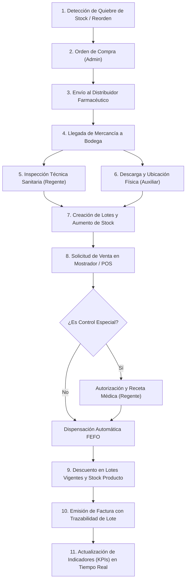

# Análisis de la Droguería Vida Sana

## 1. Flujo integrado

A continuación se detalla el ciclo integral de abastecimiento, almacenamiento, dispensación y control sanitario de la Droguería Vida Sana, ubicada en Cartago (Valle del Cauca), estructurado bajo el flujo:
**Orden de compra → Recepción por lote → Inventario → Venta FEFO → Documento → Indicador**

### Paso a paso del proceso:

1. **Detección de necesidad (Quiebre de stock o punto de reorden):**
   - El sistema monitorea continuamente las existencias de medicamentos de venta libre, fórmula médica, control especial y cuidado personal.
   - Cuando el inventario vigente no vencido de un producto (por ejemplo, *Amoxicilina 500mg* o *Jarabe Antitusivo*) desciende al umbral mínimo de seguridad, el sistema genera automáticamente una sugerencia de reposición en el panel del administrador.

2. **Orden de compra (Módulo de Compras):**
   - El **administrador (dueño)** revisa las sugerencias y crea formalmente una Orden de Compra dirigida a distribuidores autorizados (por ejemplo, «Distribuidora Farmacéutica del Valle»).
   - Se crea el encabezado de compra (`purchases`) y sus líneas de detalle (`purchase_details`), especificando productos, cantidades solicitadas y costos pactados.
   - La orden pasa al estado **EMITIDA / PENDIENTE**. En este punto no existe movimiento de inventario físico ni lotes asignados, garantizando que no se inflen las existencias disponibles para venta.

3. **Recepción por lote y verificación técnica (Módulo de Recepción y Lotes):**
   - El distribuidor entrega la mercancía en la droguería con su respectiva remisión y factura comercial.
   - **Cumplimiento estricto de segregación de funciones:** El administrador (quien generó la compra) **no interviene** en la recepción en bodega.
   - El **auxiliar de bodega** realiza la descarga física, conteo de bultos y verificación de empaques secundarios.
   - El **regente de farmacia** (responsable técnico ante las autoridades sanitarias como el INVIMA) realiza la **inspección técnica obligatoria**:
     - Verifica integridad del empaque primario, rotulado y número de registro sanitario INVIMA.
     - Valida la cadena de frío (si aplica).
     - Registra detalladamente el **número de lote** de laboratorio y la **fecha de vencimiento** de cada caja recibida.
   - Se crean o alimentan los registros correspondientes en la tabla `lots` (`product_id`, `lot_number`, `expiration_date`, `quantity`).
   - La orden de compra cambia a estado **RECIBIDA** (o **PARCIALMENTE RECIBIDA** si la entrega vino fraccionada).

4. **Almacenamiento e Inventario:**
   - Cada caja se ingresa al inventario asociado a su registro de lote específico.
   - Se incrementa tanto el inventario por lote (`lots.quantity`) como el acumulado general del producto (`productos.stock`).
   - El auxiliar de bodega ubica los productos en la estantería aplicando el principio físico de almacenamiento FEFO: los lotes con vencimiento más próximo se sitúan al frente, y los de mayor vigencia detrás.

5. **Venta y Dispensación FEFO (First Expired, First Out) (Módulo de Ventas):**
   - Un cliente se presenta en el mostrador solicitando un medicamento.
   - El **cajero** busca el producto en la terminal de punto de venta (POS).
   - **Filtro de Control Especial:** Si el medicamento es de control especial, el sistema bloquea la facturación directa y exige la validación presencial/digital del **regente de farmacia** (permiso `dispensar-control-especial`) junto con el número de fórmula médica y cédula del prescriptor.
   - El sistema ejecuta el servicio transaccional `DispensingService::dispense($product, $quantity)` bajo `DB::transaction`:
     - **Descarta los lotes vencidos** (`expiration_date < HOY`).
     - **Verifica que el stock no vencido sea suficiente** para cubrir la cantidad demandada. Si no alcanza, lanza una excepción de validación (`ValidationException`) y aborta la transacción sin tocar el inventario.
     - **Aplica el algoritmo FEFO:** Ordena los lotes vigentes en orden ascendente de fecha de caducidad (`orderBy('expiration_date', 'asc')`) y descuenta las unidades prioritariamente del lote más próximo a caducar. Si dicho lote no es suficiente, agota sus existencias y descuenta el saldo restante del siguiente lote vigente.
     - **Descuenta el stock total:** Actualiza el campo `stock` de la tabla general de productos.

6. **Generación del Documento y Trazabilidad:**
   - Se procesa el pago (efectivo, tarjeta o transferencia) y se genera la factura o ticket de venta (`sales` y `sale_details`).
   - Se almacena la trazabilidad del lote despachado (`lot_id`) en cada detalle de venta.
   - Se imprime la factura con las advertencias de uso y, para medicamentos de control especial, se genera el comprobante para el libro oficial de control de medicamentos fiscalizados.

7. **Actualización de Indicadores (KPIs):**
   - De manera inmediata, el dashboard del dueño y del regente actualiza las métricas clave: rotación por categoría, alerta de lotes a vencer en 30/60/90 días, margen bruto y confiabilidad de proveedores.

---

## 2. Reglas de negocio

| # | Regla de Negocio | Módulo | DÓNDE se implementaría | Explicación Técnica y Justificación |
|---|---|---|---|---|
| **R1** | **Dispensación estricta FEFO sin venta de lotes vencidos:** Nunca se vende un lote vencido (`expiration_date < HOY`). Se debe despachar primero el lote no vencido con la fecha de caducidad más cercana. | Ventas / Inventario | **Servicio** (`DispensingService`) | Se encapsula en la capa de servicios dentro de un bloque `DB::transaction` con bloqueos pesimistas `lockForUpdate()`. Si el stock no vencido es insuficiente, aborta la operación vía `ValidationException`. |
| **R2** | **Segregación de funciones en compras y recepción:** El usuario que elabora la orden de compra no puede ser el mismo que registra la recepción técnica o física en bodega. | Compras / Bodega | **Form Request** (`ReceivePurchaseRequest`) y **Policy** (`PurchasePolicy`) | En la autorización de la solicitud HTTP se valida `auth()->id() !== $purchase->created_by`. De coincidir, se rechaza la petición con código HTTP 403 Forbidden. |
| **R3** | **Autorización obligatoria para medicamentos de control especial:** Un medicamento de control especial no puede ser vendido por un cajero sin la aprobación expresa del regente de farmacia y la captura de datos de la fórmula médica. | Ventas / Dispensación | **Middleware** (`EnsureSpecialControlAuthorized`) y **Form Request** (`StoreSaleRequest`) | El Form Request exige campos de fórmula médica (`prescription_number`, `doctor_license`). El middleware valida que la sesión contenga la firma/permiso del regente (`dispensar-control-especial`). |
| **R4** | **Unicidad e integridad del lote por producto:** Un número de lote debe ser único para un mismo producto y su fecha de vencimiento debe ser estrictamente futura al momento de la recepción. | Lotes / Inventario | **Form Request** (`StoreLotRequest`) y **Migración** (Base de datos) | Se valida con `Rule::unique('lots')->where('product_id', $productId)` y `expiration_date => 'required|date|after:today'`. En base de datos se blinda con el índice único `unique(['product_id', 'lot_number'])`. |
| **R5** | **Restricción de acceso modular por perfil (RBAC):** Los cajeros y auxiliares de bodega no pueden acceder a la configuración de costos, edición de usuarios ni anulación de órdenes de compra. | Seguridad / Núcleo | **Middleware de Rutas** (`role_or_permission`) | Se protegen los grupos de rutas con los middlewares de Spatie (`PermissionMiddleware` / `RoleMiddleware`), asegurando denegación por defecto ante accesos no autorizados. |
| **R6** | **Bloqueo preventivo visual y alertas de caducidad:** En la interfaz de ventas se debe ocultar o deshabilitar cualquier lote vencido, y en el panel de inventario los lotes próximos a vencer (< 30 días) deben destacarse con alertas visuales de advertencia. | Vistas / Frontend | **Vista Blade** / Componente UI (Frontend) | Directivas `@can` y helpers de vista que evalúan el estado del lote, inhabilitando los botones de selección en el POS cuando el stock vigente no cubre la demanda. |
| **R7** | **Atomicidad e indivisibilidad en ventas con quiebre de stock:** Si el cliente solicita $N$ unidades y solo hay $M < N$ unidades vigentes, la operación no debe descontar existencias parciales salvo aceptación expresa del usuario. | Ventas | **Servicio** (`DispensingService`) | Garantizado por la reversión automática de la transacción (`DB::rollBack()`) ante el disparo de `ValidationException`. |

---

## 3. Estados

### Estados de una Orden de Compra y su impacto en el inventario:

| Estado de Orden de Compra | Descripción Operativa | Impacto en el Inventario |
|---|---|---|
| **BORRADOR (`draft`)** | La orden se encuentra en formulación por parte del administrador. No ha sido enviada al distribuidor. | **Sin afectación.** No hay impacto físico ni lógico en el stock ni en la tabla de lotes. |
| **EMITIDA / APROBADA (`issued`)** | Aprobada y transmitida a la Distribuidora Farmacéutica del Valle. La mercancía está en tránsito. | **Sin afectación física.** En los reportes de reabastecimiento se registra como *stock comprometido en tránsito*, pero **no** está disponible para la venta. |
| **PARCIALMENTE RECIBIDA (`partially_received`)** | El distribuidor entrega una primera remisión de mercancía. El regente y auxiliar reciben parte de lo pedido. | **Aumento parcial.** Se crean y registran los lotes específicos de las unidades efectivamente recibidas y verificadas sanitariamente. Se incrementa el stock por el monto entregado. |
| **RECIBIDA TOTAL (`received`)** | El proveedor completó el 100% de los medicamentos solicitados con sus respectivos lotes de laboratorio. | **Aumento total.** Todos los lotes quedan creados en `lots` y el stock general queda completamente disponible para la venta en el POS. |
| **ANULADA / CANCELADA (`cancelled`)** | Cancelación formal por quiebre de inventario del distribuidor o acuerdo comercial. | **Sin afectación.** La orden se archiva sin modificar inventarios ni generar lotes. |

### Estados de una Venta y su impacto en el inventario:

| Estado de una Venta | Descripción Operativa | Impacto en el Inventario |
|---|---|---|
| **EN PROCESO / COTIZACIÓN (`pending`)** | El cajero ingresa los productos a la orden del cliente en caja mientras este reúne el dinero. | **Sin descuento físico.** Opcionalmente se puede bloquear temporalmente el stock en memoria durante 5 minutos para evitar ventas cruzadas concurrentes. |
| **PAGADA / COMPLETADA (`completed`)** | El cliente efectúa el pago, se aprueba el despacho y se emite la factura de venta. | **Descuento en firme.** Se descuenta inmediatamente de los lotes vigentes correspondientes bajo la regla FEFO (`lots.quantity -= n`) y del stock general del producto (`productos.stock -= n`). |
| **ANULADA / DEVUELTA (`cancelled` / `refunded`)** | Anulación de la transacción el mismo día o devolución inmediata autorizada por regente. | **Reingreso controlado.** Si el medicamento no salió de la droguería y conserva cadena de custodia, se reingresa al lote de procedencia. Si sufrió deterioro, se desvía a bodega de bajas/averías sin retornar al inventario vendible. |

---

## 4. Indicadores (KPIs)

Para la toma de decisiones estratégicas del dueño de la Droguería Vida Sana, se establecen los siguientes indicadores clave:

### 1. Unidades e inventario próximo a vencer en 30, 60 y 90 días (Riesgo de Caducidad)
- **Objetivo:** Prevenir pérdidas financieras por medicamentos que alcancen su fecha de vencimiento en estantería y evitar riesgos sanitarios al paciente.
- **Fórmula de cálculo:**
  $$\text{Stock Próximo a Vencer (30d)} = \sum_{\text{lots}} \text{quantity} \quad \text{donde } \text{expiration\_date} \in [\text{HOY}, \text{HOY} + 30 \text{ días}]$$
- **Utilidad para el dueño:** Permite ejecutar decisiones oportunas: acordar devoluciones o canjes con el distribuidor antes del vencimiento (según política comercial del laboratorio), realizar descuentos promocionales en el mostrador para medicamentos de venta libre, o priorizar su dispensación.

### 2. Costo financiero de merma por medicamentos vencidos (Pérdida Sanitaria)
- **Objetivo:** Cuantificar el dinero perdido debido a productos que no lograron venderse antes de expirar.
- **Fórmula de cálculo:**
  $$\text{Pérdida por Vencimiento (\$)} = \sum_{\text{lots vencidos}} (\text{quantity} \times \text{precio\_costo\_compra})$$
- **Utilidad para el dueño:** Evalúa la efectividad de la política de compras y el cumplimiento del modelo FEFO. Una merma alta evidencia compras sobredimensionadas a distribuidores o fallas del personal en la rotación de estanterías.

### 3. Índice de rotación de inventario por categoría farmacéutica
- **Objetivo:** Conocer cuántas veces se renueva el inventario de medicamentos en un período determinado (mensual/anual).
- **Fórmula de cálculo:**
  $$\text{Rotación de Inventario} = \frac{\text{Costo de los Medicamentos Vendidos (COGS)}}{\text{Inventario Promedio en Lotes Vigentes}}$$
- **Utilidad para el dueño:** Permite clasificar los productos bajo análisis ABC: identificar medicamentos de alta rotación (como analgésicos de venta libre) que nunca deben tener quiebres de stock, frente a medicamentos de control especial o de baja demanda que deben manejarse bajo pedidos contra demanda para no inmovilizar capital de trabajo.

### 4. Tasa de cumplimiento de pedidos del distribuidor (% OTIF - On-Time In-Full)
- **Objetivo:** Medir la confiabilidad de proveedores como «Distribuidora Farmacéutica del Valle».
- **Fórmula de cálculo:**
  $$\% \text{OTIF} = \left( \frac{\text{Órdenes de Compra recibidas a tiempo y completas}}{\text{Total de Órdenes de Compra emitidas}} \right) \times 100$$
- **Utilidad para el dueño:** Identifica si los quiebres de stock en la droguería son causados por retrasos del proveedor, facilitando negociaciones o cambio de distribuidores farmacéuticos.
